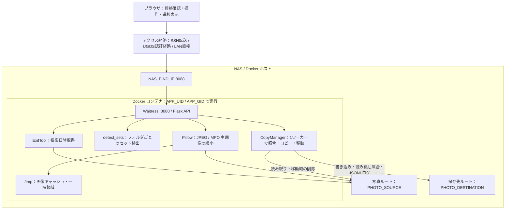

# インターバル撮影の写真分類

通常撮影とインターバル撮影が混在する写真フォルダから、ほぼ一定間隔で撮影されたセットを抽出し、同名の JPG / RAW をまとめて分類するツールです。NAS 内で動かす Web GUI と、Mac のターミナルで動かす CLI があります。

| 項目 | NAS Web GUI | Mac CLI |
| --- | --- | --- |
| 実行環境 | NAS / Linux の Docker・Docker Compose | macOS・Python 3.10 以上（外部パッケージ不要） |
| 判定する日時 | JPG の Exif 撮影日時（秒以下・時差情報にも対応） | JPG のファイル作成日時 |
| 解析範囲 | 選択フォルダのみ、または子フォルダを含む全階層 | 指定フォルダ直下 |
| 確認方法 | サムネイル、前後写真、拡大表示、ファイル一覧 | ターミナルの候補一覧 |
| 保存操作 | コピー、内容照合後の移動 | 移動 |

既定の検出条件は、撮影間隔3〜30秒・許容幅1秒・5枚以上です。許容幅は **撮影間隔の最大値と最小値の差** です。19・17・19・17秒の列は許容幅1秒では除外し、2秒なら検出します。途中抜けの補完はせず、通常撮影でも条件に合えば候補になるため、保存前に画像を確認してください。

JPG/JPEG と同じベース名の RAW を、各撮影フォルダおよび直下の `RAW` フォルダから探します。GUI では子フォルダも解析できますが、セットの検出と前後比較はフォルダごとに独立して行います。

## GUI 版のデプロイ

### 1. NAS に配置する

NAS で Docker・Docker Compose と Git が使え、SSH 接続できることを確認します。UGREEN DXP4800 Plus での利用を想定した構成です。Docker の操作権限がない場合は、以下の例のように `sudo` を使います。BuildKit / buildx は必須ではありません。

NAS の SSH セッションで、アプリを置くディレクトリに移動して実行します。

```sh
git clone --branch main https://github.com/photo-akky/script-library.git
cd script-library/scripts/interval_photos
cp .env.example .env
id -u
id -g
```

すでに clone 済みなら既存の配置先を使い、`.env` を上書きせず必要な項目だけ設定してください。Git を使えない場合の配置・移行手順は [詳細手順](WEB_README.md) を参照してください。

### 2. `.env` を設定する

`.env` をテキストエディタで開き、次を設定します。写真ルートと保存先は、事前に作成した NAS 上の絶対パスを指定してください。以下のパスと UID/GID は例です。UID/GID は先ほどの `id -u` / `id -g` の結果に置き換えてください。

```dotenv
PHOTO_SOURCE=/path/to/photos
PHOTO_DESTINATION=/path/to/timelapses
NAS_BIND_IP=127.0.0.1
APP_UID=1234
APP_GID=2345
```

| 設定 | 用途 |
| --- | --- |
| `PHOTO_SOURCE` | 写真ルート。コンテナ内の `/photos` にマウント |
| `PHOTO_DESTINATION` | コピー・移動先ルート。コンテナ内の `/copies` にマウント |
| `NAS_BIND_IP` | 公開ポート8088を割り当てる NAS の IP。既定は NAS 内のループバックのみ |
| `APP_UID` / `APP_GID` | NAS で実行した `id -u` / `id -g` の数値。ビルド時・実行時のユーザーに使用 |

`.env` は Git 管理対象外です。実在のパスや個人の設定は、このファイルに保存します。元写真を読む権限と、保存先に書き込む権限が必要です。移動する場合は元ファイルの親フォルダに削除権限も必要です。写真ルートと保存先には別の独立したディレクトリを指定し、再帰解析の対象に保存済みデータを含めない配置にします。

`PHOTO_TIMEZONE` は `compose.yaml` で `Asia/Tokyo` に設定しています。Exif に時差情報がない場合の解釈に使うため、必要なら変更してください。`ALLOW_MOVE: "1"` により移動が有効です。コピー専用で運用する場合は `"0"` にし、写真ルートのマウントも `read_only: true` に変更できます。

### 3. 起動して接続する

```sh
sudo docker compose config --quiet
sudo docker compose up -d --build
sudo docker compose ps
sudo docker compose logs --tail=50
```

コンテナ内の Waitress が8080番で待ち受け、Compose が NAS の8088番へ公開します。アクセス方法は次の「認証とアクセス方法」から選びます。

接続後は、撮影フォルダを開いて「このフォルダを解析」または「子フォルダを含めて解析」を押します。サムネイルと前後写真を確認し、セットを選んでコピーまたは移動を実行します。既定はコピーで、移動時は元 JPG / RAW を削除する確認画面が出ます。

### 4. 更新・停止する

コピー・移動が完了してから、アプリのディレクトリで更新します。`main` をチェックアウトした配置先で実行してください。

```sh
git pull --ff-only
sudo docker compose up -d --build
```

スクリプトはイメージ内に格納するため、`git pull` や単なるコンテナ再起動だけではコードが反映されません。更新後はブラウザを再読み込みして再解析します。既存の `.env` は保持されます。

停止は `sudo docker compose down`、停止済みの同じイメージで再開する場合は `sudo docker compose up -d` です。処理中の停止・再ビルドは避けてください。

## 認証とアクセス方法

**アプリ自身にはログイン・ユーザー管理・ユーザー別の権限制御がありません。** アプリへ接続できる人は、設定した写真ルートを閲覧し、コピーや有効化された移動を実行できます。認証はアクセス経路側で行います。

| 方法 | 設定と認証 | アクセス先 |
| --- | --- | --- |
| SSH ポート転送 | `NAS_BIND_IP=127.0.0.1`。NAS の SSH アカウントで認証 | 手元の `http://localhost:8088` |
| UGOS 経由 | UGOS の認証付きアクセス経路・ショートカットを設定。UGOS アカウントで認証 | UGOS が提供するアプリの URL |
| LAN から直接 | `NAS_BIND_IP` に NAS の LAN IP を指定。アプリ側の認証なし | `http://NASのLAN-IP:8088` |

SSH 転送を使う場合は、Mac などの手元のターミナルで次を実行し、接続したままブラウザを開きます。

```sh
ssh -N -L 8088:127.0.0.1:8088 nas-user@NASのLAN-IP
```

UGOS のアクセス経路は NAS 側で別途設定するものです。Compose が UGOS のログインやショートカットを自動で作るわけではありません。UGOS のバージョンや公開設定によって接続方法が異なるため、ループバックへの接続が制限される場合は UGOS の認証付き経路を使用してください。UGOS 経由の認証を使う場合、別の LAN ポートなどから認証を経由せず接続できないことも確認してください。

LAN への直接公開は、接続者全員に操作を許せるネットワークで使います。インターネットへポート8088を直接公開しないでください。別のリバースプロキシで公開する場合も、プロキシ側に認証・HTTPS を設定し、アプリへの直接接続を制限します。プロキシ設定はこのリポジトリに含まれていません。

アプリは解析・保存 API に CSRF 対策用の `X-Scan-Token`、画像 URL に署名を使います。これらはログイン認証の代わりにはなりません。`APP_UID` / `APP_GID` は NAS のファイルアクセス権を決める設定で、ブラウザ利用者の認証には使いません。

## アーキテクチャ・構成図



ブラウザは操作と表示を担当し、写真データのコピーは NAS 内で実行します。Mac を経由して写真本体を転送する構成ではありません。異なる共有領域・ボリュームへの移動でも、保存先へコピーして内容を照合した後に元を削除します。

| ファイル | 役割 |
| --- | --- |
| `compose.yaml` / `Dockerfile` | ポート・マウント・実行権限・依存パッケージ・起動方法 |
| `web_app.py` | Flask API、Exif 読み取り、再帰解析、画像リンク発行 |
| `interval_photos.py` | 共通のセット検出ロジックと Mac CLI |
| `copy_jobs.py` | 解析結果の固定保存、コピー・移動、SHA-256 照合、処理ログ |
| `image_preview.py` | JPEG / MPO のプレビューと画像キャッシュ |
| `templates/` / `static/` | ブラウザ画面、JavaScript、スタイル |

コンテナのシステム領域は読み取り専用、写真と保存先はバインドマウントです。GUI 既定の Compose では移動に対応するため両方を読み書き可能にしています。`/tmp` は64MiBの一時領域で、画像キャッシュの上限は32MiB・256件です。解析結果と進捗はメモリ上にあり、コンテナ再起動で失われます。保存済みの写真と処理ログは NAS 側に残ります。

## 保存先とログ

写真ルートからの階層を維持し、撮影フォルダ名にフォルダ内のセット番号を付けます。例：`2026/10/11` のセット1 → `PHOTO_DESTINATION/2026/10/11-1`。RAW サブフォルダの構成も保持します。

移動では、選択した全セットの保存先を照合・同期してから元ファイルの削除を始めます。番号が変わった既存コピーは、予定先の親フォルダ直下の同じ撮影フォルダ名の `-番号` フォルダから探します。保存先全体は走査せず、候補が1つに絞れ、全件の内容が一致した場合に再利用します。

各セットの `copy-log.jsonl` / `move-log.jsonl` に、処理経過と抽出条件を記録します。抽出条件には検索フォルダ・再帰指定・分類パラメータ・解析日時が含まれます。未完了時は `COPY_INCOMPLETE` / `MOVE_INCOMPLETE` が残ります。

削除開始後の失敗では一部だけ移動済みになる場合があります。自動復元・中断後の自動再開はしないため、削除済み件数、ログ、元と保存先の実ファイルを確認してください。コピーの詳細、既存環境の移行、Compose を使わない起動方法は [Web GUI の詳細手順](WEB_README.md) に記載しています。

## Mac CLI の使い方

Python 3.10 以上、外部パッケージ不要。Finder で NAS に接続し、共有フォルダのパスを指定します。リポジトリのルートから、次のフォルダへ移動して実行してください。

```sh
cd scripts/interval_photos
```

```sh
python3 interval_photos.py "/Volumes/photos/撮影フォルダ"
```

既定は候補表示のみ。JPG/JPEG の **ファイル作成日時**を並べ、3〜30秒のほぼ一定の間隔（間隔の最大差1秒）で5枚以上続く列を抽出します。時刻が同じ写真や許容幅を外れる間隔で列を分けます。欠落分の補完はしません。全間隔の最大値と最小値の差が許容幅以内である必要があります。許容幅は0以上かつ最小間隔未満で指定します。候補は重複しません。

```sh
python3 interval_photos.py "/Volumes/photos/撮影フォルダ" --min-interval 5 --max-interval 40 --tolerance 0.5 --min-count 5
```

候補を確認後、同じ条件で候補番号を指定して移動します。候補番号は毎回再計算するため、確認から移動まで元フォルダの内容を変更しないでください。

```sh
python3 interval_photos.py "/Volumes/photos/撮影フォルダ" --move --sets 1,3 --destination "/Volumes/photos/分類済み"
```

`--sets all` で全候補を移動できます。セットごとのフォルダを作り、同じベース名（拡張子を除く、大文字小文字を無視）の RAW も移動します。RAW は元フォルダと直下の `RAW` フォルダを探します。元の RAW サブフォルダ構成を維持し、複数形式があればすべて含めます。一般的な RAW 拡張子に対応し、未知の形式は `--raw-ext xyz` で追加できます。RAW がない JPG も候補になります。JPG の探索は直下のみです。

NAS が撮影時の作成日時を保持していることを候補一覧で確認してください。作成日時を取得できない場合は停止し、更新日時への置き換えはしません。この Mac CLI は Exif 判定に対応していません（NAS の Web 版は対応）。通常撮影でも等間隔なら候補になるため、移動前の確認が必要です。

移動はコピー、書き込み完了、サイズ・元ファイルの変化確認、元ファイル削除の順に実行し、既存ファイルを上書きしません。NAS 間のコピーにも対応します。Mac から NAS の別共有領域へ移動する場合、写真データは NAS → Mac → NAS と転送されます。この Mac CLI を使って NAS 内だけで処理することはできません。NAS 内での処理には上記の Web 版を使います。また、移動全体は一括トランザクションではありません。通信断などでは一部だけ移動したり、不完全なコピーが残ったりします。各セットの `move-log.jsonl` と両方のフォルダを確認してください。ファイルを使用・編集・追加するアプリは処理中停止してください。コピー先の作成日時は NAS により変わる場合があります。

検証:

```sh
python3 -m unittest discover -s tests -v
```
